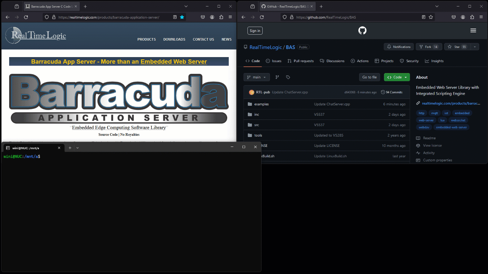

# C++ WebSocket chat example

Build a chat server that sends text and JPEG images between browser clients.
The server is written in C++, the client in JavaScript, and communication
uses the [Barracuda Embedded Web Server (BWS) WebSocket API](https://realtimelogic.com/ba/doc/en/C/reference/html/group__WebSockets.html).


The supplied Linux and Windows projects compile `src/BWS.c`. You can also
use the example in a Barracuda App Server (BAS) application that compiles
`src/BAS.c`; compile only one of those libraries. For application logic in
Lua, see the [BAS Lua WebSocket API](https://realtimelogic.com/ba/doc/?url=SockLib.html#WebSockets)
and [interactive tutorials](https://tutorial.realtimelogic.com/).

## How to compile and run the WebSocket chat example

Build on your computer first, then adapt the startup and porting layers
for your device.

1. [Compile the example](#how-to-compile-the-c-code) and start the server.
2. Open the server address shown in its startup output in two browser windows.
3. Enter a message in the text box at the bottom of either window.
4. Drop a JPEG image of at most 65,535 bytes into either window.

Messages and images appear in all connected clients. Text uses WebSocket
text frames; JPEGs use binary frames. The size limit is `0xFFFF` bytes.



## How to compile the C code

### Linux

Install GCC, G++, and Make, then run:

```sh
# Clone the repository and build the chat example.
git clone https://github.com/RealTimeLogic/BAS.git
cd BAS/examples/C-WebSockets/
make
./ChatServer
```

### Windows

Open `examples/C-WebSockets/VcMake/example.sln` in Visual Studio, build,
and run the project.

### RTOS

For a real-time operating system (RTOS), choose how to store the browser
files: embed them in the firmware, or serve them from a filesystem.
Embedding the files lets you try the example before adding filesystem
support.

The following Linux build shows how to embed the files. It needs `zip`
and the C/C++ toolchain. Run it from `examples/C-WebSockets`:

```sh
# Build the resource tool, then create the ZIP and C array in a subprocess.
mkdir -p obj/release
gcc -o obj/release/bin2c ../../tools/bin2c.c
PATH="$PWD/obj/release:$PATH" bash BuildZip.sh
# GCC selects C++ for ChatServer.cpp; link the C++ runtime explicitly.
gcc -o ChatServer -I../../inc -I../../inc/arch/Posix -I../../inc/arch/NET/Posix\
    ../../src/BWS.c\
    ../../src/arch/Posix/ThreadLib.c ../../src/arch/NET/generic/SoDisp.c\
    ../HostInit/HostInit.c ../HostInit/Main.c\
    src/ChatServer.cpp\
    obj/release/html.zip.c\
    -lpthread -lm -lstdc++
```

For the device build, add these files to your project:

| File | Purpose |
| --- | --- |
| `src/BWS.c` | Web server library. |
| `src/arch/<OS>/ThreadLib.c` | Thread port for your RTOS. |
| `src/arch/NET/<NET>/SoDisp.c` | Dispatcher for your network stack. |
| `examples/C-WebSockets/src/ChatServer.cpp` | Chat service. |
| `src/DiskIo/<FS>/BaFile.c` | Filesystem port, if using disk resources. |

Paths in this table are relative to the repository root. Select the
matching headers from [Porting Layers](../../doc/compiling.md#porting-layers).
Replace `Main.c` and `HostInit.c` with your target's startup code, then call
`barracuda()` from a dedicated task after initializing the platform and
network. The [Xedge integration guide](../../doc/compiling.md#xedge-rtos)
also describes this startup pattern.

#### Option 1: Using an embedded filesystem

Compile `BaFile.c` and define `BAIO_DISK`. Copy the contents of `html` to
the device, then set the `DiskIo` root in `installVirtualDir()` in
`src/ChatServer.cpp` to that directory.

#### Option 2: Embedding the HTML files in the firmware

Compile `tools/bin2c.c` as a host tool and put `bin2c` on your path. From
`examples/C-WebSockets`, create the resource array:

```sh
# Keep index.html at the ZIP root and export the reader expected by ChatServer.cpp.
cd html
zip -D -r -9 ../html.zip *
cd ..
bin2c -z getZipReader html.zip html.zip.c
```

Add `html.zip.c` to the device build and leave `BAIO_DISK` undefined.

### Ready-to-run RTOS build

The [SharkSSL ESP32 IDE](https://realtimelogic.com/downloads/sharkssl/ESP32/)
includes this chat example. The animation shows building and uploading it,
then opening the chat server in a browser.


## Random-generator initialization


The native example calls the shared `HostInit/ExampleRng.h` helper before
creating server objects. This is a platform-neutral demonstration: hashing an
address into a 48-byte seed does not create entropy. Replace it with a checked
`sharkssl_entropyEx` call using at least 48 bytes from a secure platform source
before production TLS or authentication. Later native reseeds require at
least 32 bytes. A PSA build must initialize its provider first; the helper
uses the PSA-only no-argument initializer instead of injecting a seed.
